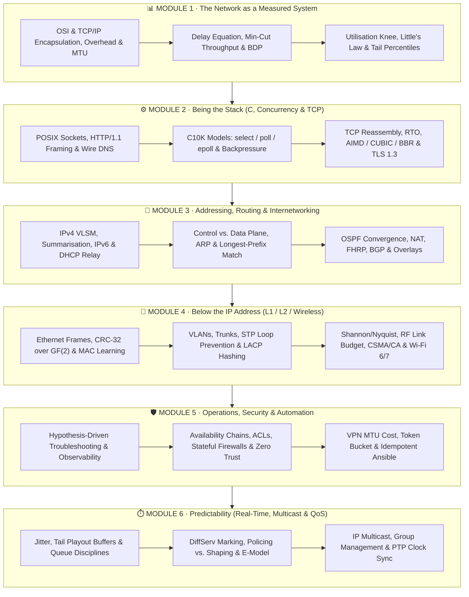

# 🌐 Computer Networks & Network Programming
### `25CS2208E` · Complete Course Syllabus & Systems Learning Roadmap

  <em>Engineering networks from the wire up—measuring every microsecond, implementing the TCP/IP stack from scratch in C, operating routing & switching fabrics as code, diagnosing silent L1–L7 faults, and defending tail-latency budgets under congestion.</em>

 

[✨ What You Will Learn](#-what-you-will-learn) •
[🛠️ Tools & Stack](#️-networking-tools--protocol-stack) •
[🗺️ Curriculum Map](#️-curriculum-architecture-map) •
[📚 6 Core Modules](#-detailed-module-wise-syllabus) •
[🎓 Outcomes](#-course-outcomes-cos) •
[🧪 12-Week Labs](#-12-week-hands-on-lab-progression) •
[🔍 Fault Matrix](#-l1l7-fault-diagnosis-matrix) •
[📖 Resources](#-certifications-books--moocs)

---

> [!IMPORTANT]
> **Course Philosophy:** *A network that is fast on average and a network that is predictable are two completely different engineering problems.*
>
> This course owns **the protocol stack, the wire, and the fabric**—building directly on **Operating Systems & System Programming (OSSP)**, **C**, and **DSA-1**, and preparing learners for **System Design for Scalability (SDSR)**, **Cloud & Distributed Infrastructure (CDIS)**, security, and systems engineering roles.

---

## ✨ What You Will Learn

Rather than memorizing static layer diagrams, this course approaches computer networking as a **measurement-first, systems-programming discipline** across six core pillars:

| Pillar | Core Competencies & Systems Engineering Skills |
| :--- | :--- |
| **1. Measurement & Queueing** | Account for every microsecond of a transfer using the delay equation, min-cut throughput, utilisation curves, Little's Law, Bandwidth-Delay Product (BDP), tail percentiles ($p_{50}$ / $p_{99}$), and three-point packet captures. |
| **2. Protocol Stack in C** | Implement transport and application protocols from scratch in **C**—POSIX sockets, HTTP/1.1 framing, wire-format DNS, C10K `epoll` event loops with backpressure, out-of-order TCP reassembly, Jacobson/Karels RTO, AIMD congestion control, and TLS 1.3 termination. |
| **3. Addressing & Routing** | Design scalable IPv4 VLSM & IPv6 plans, route summarisation, DHCP relay, ARP, Longest-Prefix Match (LPM) forwarding, Distance-Vector vs. Link-State routing, OSPF convergence budgets, NAT, first-hop redundancy, BGP policy routing, and overlay MTU overhead. |
| **4. Link, Physical & Wireless** | Analyze Ethernet frames, bit-exact CRC-32 over $\text{GF}(2)$, MAC learning, 802.1Q VLANs, STP loop prevention, LACP hashing, Shannon & Nyquist limits, RF link budgets, CSMA/CA airtime fairness, Wi-Fi 6/7, and constrained low-power links. |
| **5. Operations & Security** | Apply a formal hypothesis-driven troubleshooting loop; compute availability chains; enforce order-sensitive ACLs, stateful firewalls, Zero Trust edge identity, VPN MTU budgets, token-bucket rate limiters, and idempotent **Ansible** automation. |
| **6. Real-Time QoS & Time** | Defend bounded latency and jitter budgets under sustained contention using tail-sized playout buffers, Linux queue disciplines (`TBF`, `HTB`, `FQ-CoDel`), DiffServ policing vs. shaping, the ITU-T E-model, IP multicast, and sub-millisecond **PTP** sync. |

---

## 🛠️ Networking Tools & Protocol Stack

| Domain | Languages, Daemons, Protocols & Instruments Covered |
| :--- | :--- |
| **Systems & Stack Code** |    `HTTP/1.1` · `DNS` · `TCP` · `ARP` · `CRC-32` |
| **Virtual Fabric & Routing** | -0f766e?style=flat-square) -1d4ed8?style=flat-square)  |
| **Core Network Services** | -047857?style=flat-square) -b45309?style=flat-square) -334155?style=flat-square) -7c3aed?style=flat-square) |
| **Traffic Control & QoS** | -dc2626?style=flat-square) `DiffServ / DSCP` · `IP Multicast` · `E-Model` |
| **Diagnostics & NetOps** |    `tcpdump` · `ss` · `iperf3` · `mtr` · `dig` |

---

## 🗺️ Curriculum Architecture Map

---

## 📚 Detailed Module-Wise Syllabus

### 📊 Module 1 · The Network as a Measured System (`CO1`)
> **Focus:** Layering, byte-level encapsulation, delay & queueing mathematics, and defending network behaviour from empirical packet captures.

* **Layering & Encapsulation:** Why layering exists; OSI vs. TCP/IP models and why both survive; exact header overhead at each layer; how **MTU** constraints propagate upward (including silent MTU black holes).
* **The Delay Equation & Min-Cut Throughput:** Breaking end-to-end transfer time into **serialisation, propagation, queueing, and processing** delays; why path throughput is the **min-cut** rather than the average; reading a network path from **three-point packet captures**.
* **Queueing Dynamics & Little's Law:** Utilisation ($\rho$) as the master variable; deriving the queueing-delay curve and finding the **knee**; **Little's Law** ($L = \lambda W$) and why it is more general than it looks; where idealized $M/M/1$ models mislead engineers.
* **BDP, Percentiles & Bufferbloat:** **Bandwidth-Delay Product (BDP)** and bytes in flight; jitter and tail percentiles ($p_{50}$, $p_{99}$, $p_{99.9}$) vs. deceptive averages; packet loss, buffer sizing, and the trap of adding excessive buffer memory.

---

### ⚙️ Module 2 · Being the Stack — Sockets, Concurrency, TCP & TLS (`CO2`)
> **Focus:** Building application and transport protocols from scratch in C, breaking through the C10K concurrency wall, and proving interoperability with the Linux kernel.

* **Sockets, Framing & Application Protocols:** POSIX sockets as kernel syscalls; `listen()` SYN/accept backlog queues; the six classic failure modes in networked C code; message **framing** underneath every protocol; implementing **HTTP/1.1**; round trips as the currency of latency; **DNS** wire-format parsing, resolution chains, TTLs, and DNS as a load-balancing control plane.
* **Concurrency & The C10K Problem:** True memory and CPU cost of 10,000 concurrent connections; benchmarking four I/O models (**thread-per-connection, `select()`, `poll()`, and `epoll`/`kqueue`**); level-triggered vs. edge-triggered notifications; non-blocking event loops, **backpressure**, multi-core scaling, and connection timeouts at scale.
* **UDP & TCP Mechanics:** UDP's minimal contract vs. TCP's reliable byte-stream state machine; 32-bit sequence number wrap-around; out-of-order **stream reassembly** at bounded memory; flow control windows; deriving the **Jacobson/Karels RTO** retransmission timer; connection teardown, `TIME_WAIT` exhaustion, and **Nagle's algorithm vs. Delayed ACK**.
* **Congestion Control & Modern Variants:** The 1986 congestion collapse; congestion window (`cwnd`) vs. receive window (`rwnd`); **Slow Start**, **AIMD**, **Fast Retransmit**, and **Fast Recovery**; predicting throughput via the **Mathis relation** and explaining empirical gaps; fairness illusions; modern congestion signals (**CUBIC, BBR, and ECN**).
* **Transport Security (TLS 1.3):** Handshake latency, **TLS 1.3** termination, X.509 certificate chain validation, hostname verification, and **ALPN** protocol negotiation.

---

### 🧭 Module 3 · Addressing, Routing & Internetworking (`CO3`)
> **Focus:** Designing scalable IPv4/IPv6 addressing architectures, dynamic routing control planes, L3 forwarding engines, and resilient multi-uplink topologies.

* **IP Addressing & Subnet Architecture:** Prefix arithmetic to fluency; **VLSM** design for multi-year growth; **route summarisation**; special-purpose address ranges; **IPv6** addressing and operational deployment; translating subnet planning to cloud VPCs.
* **Dynamic Host Configuration:** **DHCPv4** end-to-end (`DORA`), DHCP relay agents across routed boundaries, and systematic diagnostic order when a client has no IP address.
* **Control Plane vs. Data Plane:** Why separating route computation from packet forwarding scales the internet; **Longest-Prefix Match (LPM)** lookup; **ARP** straddling the L2/L3 boundary; IPv4 TTL decrement and header checksums.
* **Routing Algorithms & Protocols:** **Distance-Vector** vs. **Link-State** algorithms on a graph; count-to-infinity and its three mitigations; **OSPF** internals and convergence budgets; route-selection order (prefix length $\rightarrow$ administrative distance $\rightarrow$ metric).
* **Internet Edge & Overlays:** **NAT** mechanics and how it broke the end-to-end model; **First-Hop Redundancy Protocols (FHRP)** and dual-uplink failover without black-holing; why **BGP** is a policy protocol rather than shortest-path; tunneling/overlay encapsulation and its **MTU** penalty.

---

### 📡 Module 4 · Below the IP Address — Ethernet, Switching, Media & Wireless (`CO4`)
> **Focus:** Layer-1 physics, Layer-2 switching fabrics, wireless contention, and diagnosing silent hardware/link faults that emit zero error messages.

* **Ethernet Frames & Error Detection:** Frame anatomy and what the Frame Check Sequence (**FCS**) guarantees; implementing **CRC-32** as polynomial division over $\text{GF}(2)$ including burst-error detection.
* **Switching Fabrics & Redundancy:** Transparent **MAC learning**; **802.1Q VLANs** and trunk tagging; why Layer-2 loops trigger catastrophic broadcast storms; **Spanning Tree Protocol (STP)**; **Link Aggregation (LACP)** and flow-hashing imbalances; virtual switching inside servers (`Open vSwitch`).
* **Physical Media & Capacity Ceilings:** Copper/fiber budgets and **PoE power limits**; **Nyquist** noiseless and **Shannon–Hartley** noisy channel capacity limits; access-port security and duplex mechanics.
* **Wireless & RF Engineering:** The **RF link budget** (dBm, path loss, noise floor); why Wi-Fi uses **CSMA/CA** instead of CSMA/CD; the **hidden-node problem**; mapping **SNR to data rates** via the MCS ladder; 2.4 / 5 / 6 GHz bands; **airtime** as the real shared resource; client roaming; channel planning, airtime fairness, and what **Wi-Fi 6 and Wi-Fi 7** actually change.
* **Constrained Low-Power Links:** Small MTUs, radio duty cycles, and distinguishing wireless capacity exhaustion from RF coverage problems.

---

### 🛡️ Module 5 · Running What You Built — Operations, Security & Automation (`CO5`)
> **Focus:** Production NetOps, formal incident troubleshooting, security policy enforcement, and idempotent automation.

* **Formal Troubleshooting Methodology:** *Problem Statement* $\rightarrow$ *Falsifiable Hypothesis & Test* $\rightarrow$ *Elimination* $\rightarrow$ *Empirical Evidence* $\rightarrow$ *One-Change Fix (with blast radius & rollback plan)* $\rightarrow$ *User-Viewpoint Verification*.
* **Observability & Availability Arithmetic:** Matching telemetry tools to visibility layers; managing metric **cardinality** and flow sampling costs; computing series/parallel **availability chains** and SLO error budgets (e.g., `99.99%` = `4.32 min/month`).
* **Security & Rate Limiting:** Stateless **ACLs** and **stateful firewalls** (why rule order *is* policy); identity at the edge and **Zero Trust** principles; **VPN** encapsulation overhead and MTU impact; **token-bucket rate limiting**.
* **Idempotent Automation & NetOps:** Why **idempotency** makes network changes safe; automating network infrastructure with **Ansible** and **Python**; comparing network management approaches, AI in NetOps, and core operational documentation artefacts.

---

### ⏱️ Module 6 · Predictability — Real-Time, Multicast & QoS (`CO6`)
> **Focus:** Bounding tail latency and jitter for time-sensitive traffic under sustained competing load.

* **Jitter & Queueing Disciplines:** Sizing real-time **playout buffers** on the tail rather than the mean; comparing queue disciplines (**FIFO, TBF, HTB, FQ-CoDel, LLQ**) and knowing exactly what each discipline bounds.
* **QoS Architecture:** **DiffServ (DSCP)** classification and marking; **policing vs. shaping** trade-offs; diagnosing why uncoordinated QoS breaks end-to-end.
* **Real-Time Media & Delay Budgets:** Codec bitrates vs. actual **wire rates** (RTP/UDP/IP/L2 overhead); quantifying perceptual call quality with the **ITU-T E-model**; accounting for every millisecond across a congested path.
* **Multicast & Precision Time:** **IP Multicast** forwarding and group management (`IGMP`/`MLD`); **Precision Time Protocol (PTP / IEEE 1588)** for sub-millisecond clock synchronisation and asymmetric path errors that cannot be measured away.

---

## 🎓 Course Outcomes (COs)

| CO | Outcome Statement | Bloom's Level |
| :---: | :--- | :---: |
| **CO1** | **Analyze** a network as a measured system—layering, encapsulation, header overhead, MTU, delay equation, min-cut throughput, queueing knee, Little's Law, BDP, jitter, and percentiles—accounting for every microsecond using packet captures. |  |
| **CO2** | **Create** transport and application layers from scratch in C—sockets, framing, HTTP/1.1, DNS, `select`/`poll`/`epoll` at 10,000 connections, TCP reassembly, RTO, AIMD congestion control checked against Mathis, and TLS—interoperating with an unmodified Linux kernel TCP peer over an impaired link. |  |
| **CO3** | **Apply** prefix arithmetic, VLSM, summarisation, IPv6, DHCP relay, longest-prefix match, ARP, distance-vector & link-state routing, OSPF convergence budgets, NAT, FHRP, BGP, and overlays to build a resilient internetwork as code with dual uplinks and bounded failover. |  |
| **CO4** | **Analyze** link and physical layers—Ethernet FCS, CRC over $\text{GF}(2)$, MAC learning, VLANs/trunks, STP, LACP hashing, Shannon/Nyquist limits, RF link budgets, CSMA/CA, MCS ladders, airtime fairness, roaming, and constrained links—and diagnose silent faults. |  |
| **CO5** | **Evaluate** and operate networked infrastructure using formalised troubleshooting, observability, availability arithmetic, ACLs/stateful firewalls, Zero Trust, VPN MTU budgets, token buckets, and idempotent Ansible automation—root-causing injected faults under time constraints. |  |
| **CO6** | **Create** and defend a measured latency and jitter budget for time-sensitive traffic—playout buffers, queue disciplines, DiffServ policing/shaping, E-model, multicast, and PTP synchronisation—verified as $p_{50}/p_{99}$ distributions under sustained contention. |  |

---

## 🧪 12-Week Hands-On Lab Progression

<b>Click to expand / collapse the 12-Week Practical Lab & Systems Progression</b>

 

| Week | Module | Core Concepts & Practical Lab Focus | Verification Target |
| :---: | :---: | :--- | :--- |
| **W01** | `M1` | Encapsulation overhead, three-point captures, kernel socket client (`webget`), and a flow-controlled `ByteStream` in C | Byte-accurate stream under tight capacity |
| **W02** | `M1` | Queueing-delay knee, Little's Law verification, BDP, bufferbloat, and baseline latency/jitter under `tc netem` impairment | Measured $p_{50}/p_{99}$ baseline curves |
| **W03** | `M3` | Prefix arithmetic, VLSM address planning, route summarisation, DHCPv4 relay deployment, and first live fault diagnosis | Zero-overlap subnet plan & relayed lease |
| **W04** | `M2` | POSIX socket backlog queues, HTTP/1.1 framing server in C, and wire-format DNS resolver across six record types | Browser-rendered HTTP & `dig`-matched DNS |
| **W05** | `M2` | Benchmarking blocking, `select()`, `poll()`, and `epoll` (level vs. edge-triggered) with partial I/O, backpressure & timeouts | 10,000 concurrent connections & cost curves |
| **W06** | `M2` | Out-of-order TCP `Reassembler` (32-bit seqno wrap), TCP `Receiver`, `Sender`, Jacobson/Karels RTO & 3-dup-ACK fast retransmit | Clean loss recovery without retransmit storms |
| **W07** | `M2` | Congestion control (Slow Start, AIMD, Fast Recovery) validated against the **Mathis relation** over injected delay & loss | **Interop Gate:** 1 MB bidirectional kernel TCP |
| **W08** | `M3` | ARP-resolving `NetworkInterface`, Longest-Prefix Match (LPM) IPv4 router in C, OSPF convergence tuning, dual-uplink failover & NAT | Sub-5s OSPF convergence & L3 forwarding |
| **W09** | `M4` | Ethernet frame layer with bit-exact **CRC-32** over $\text{GF}(2)$, 802.1Q VLANs, trunks, STP loop prevention, LACP & media budgets | Reference-identical CRC-32 on burst errors |
| **W10** | `M4` | RF link budgets, SNR-to-MCS data-rate mapping, CSMA/CA airtime fairness, channel planning & constrained low-power links | Separating wireless capacity vs. coverage faults |
| **W11** | `M5` | Availability chains, flow cardinality, ACL/firewall ordering, token buckets, idempotent **Ansible** & **TLS 1.3** chain/ALPN validation | **Diagnosis Gate:** Timed root-cause logs |
| **W12** | `M6` | Tail playout buffers, ITU-T E-model, `TBF`/`HTB`/`FQ-CoDel` queue disciplines, DiffServ, IP multicast & **PTP** synchronisation | **Integration Gate:** Defended $p_{99}$ under load |

---

## 🔍 L1–L7 Fault Diagnosis Matrix

A signature skill of this course is diagnosing real-world failures—especially **silent faults** that produce no error message—by forming falsifiable hypotheses and inspecting wire-level evidence:

| Layer | Fault Class | Typical User Symptom | Empirical Proof on the Wire / Device |
| :---: | :--- | :--- | :--- |
| **L1** | **Duplex Mismatch** | *"It's slow, but it works."* | Late collisions on half-duplex side; FCS/CRC errors on full-duplex side |
| **L1** | **PoE Budget Exceeded** | *"Edge devices reboot at random."* | Cumulative draw exceeds switch budget; lowest-priority port drops first |
| **L2** | **Native VLAN Mismatch** | *"One VLAN works, another doesn't."* | Untagged frames crossing a trunk land in the wrong broadcast domain |
| **L2** | **L2 Loop (STP Disabled)** | *"Everything on the floor died at once."* | Rapid MAC table flapping and broadcast/multicast traffic saturation |
| **L3** | **Wrong Subnet Mask** | *"I can reach some hosts, not others."* | Host broadcasts ARP for off-subnet IPs; asymmetric reachability |
| **L3** | **MTU Black Hole** | *"Small pages load; large transfers hang."* | TCP transfer stalls deterministically at the exact same byte offset |
| **L3** | **Missing DHCP Relay** | *"New devices never get an IP."* | `DHCPDISCOVER` broadcast seen on client segment, never at server |
| **L4** | **Ephemeral Port / `TIME_WAIT`** | *"Service fails only under peak load."* | Connection refusals correlate directly with socket-state counts (`ss`) |
| **L7** | **Misconfigured DNS TTL** | *"Half the users still hit the old server."* | Recursive resolvers disagree on records for the exact stale TTL window |
| **L7** | **ACL / Firewall Ordering** | *"The deny rule exists, yet traffic passes."* | First-match wins: an earlier broad `permit` shadows the specific `deny` |

---

## 💡 Classic Industry Failure Scenarios Studied

<b>Click to expand / collapse the 12 Real-World Engineering Failure Patterns</b>

 

| Week | Failure Pattern | Core Underlying Concept |
| :---: | :--- | :--- |
| **W01** | *The transfer that stopped at 1.2 MB* | Path MTU black hole over VPN encapsulation with filtered ICMP |
| **W02** | *The dashboard that was green all night* | Utilisation knee ($>90\%$) hiding severe tail latency behind a low mean |
| **W03** | *The merger that could not be routed* | Overlapping RFC 1918 address spaces (`10.0.0.0/16`) across VPN peers |
| **W04** | *The failover that took a day* | Stale DNS caching caused by overly long authoritative record TTLs |
| **W05** | *The service that was fine until it wasn't* | Event-loop starvation, missing backpressure & blocking calls under load |
| **W06** | *The transfer that ran at exactly 13 Mbit/s* | TCP receive window (`rwnd`) / BDP cap limiting throughput on high-RTT links |
| **W07** | *The upgrade that made it slower* | Buffer sizing, packet loss sensitivity & Mathis throughput ceiling on 10G links |
| **W08** | *The summary that was never advertised* | OSPF area border summarisation misconfiguration & route leaking |
| **W09** | *The building that went down at 09:14* | Layer-2 switching loop & broadcast storm with Spanning Tree disabled |
| **W10** | *The lecture theatre that failed at capacity* | Wi-Fi co-channel interference & airtime exhaustion despite strong RSSI |
| **W11** | *The change that was never made* | Uncontrolled configuration drift burning 16 months of a `99.99%` SLO budget |
| **W12** | *The QoS configured everywhere that worked nowhere* | DSCP trust boundaries, remarking & uncoordinated end-to-end queueing |

---

## 📖 Certifications, Books & MOOCs

### 🏆 Vendor-Neutral Certification Alignment
* 🛡️ **CompTIA Network+ (`N10-009`)** — Weekly objective-mapped problem sets & performance-based diagnostics.
* 🌐 **Cisco CCNA (`200-301`)** — Routing, switching, wireless, IP services, security & automation taught vendor-neutrally.

### 📘 Reference Books

| # | Title | Authors | Publisher & Edition |
| :---: | :--- | :--- | :--- |
| **1** | *Computer Networking: A Top-Down Approach* | James F. Kurose & Keith W. Ross | Pearson (8th Ed., 2021) |
| **2** | *TCP/IP Illustrated, Volume 1: The Protocols* | Kevin R. Fall & W. Richard Stevens | Addison-Wesley (2nd Ed., 2011) |
| **3** | *Unix Network Programming, Vol. 1: The Sockets API* | W. Richard Stevens, B. Fenner & A. Rudoff | Addison-Wesley (3rd Ed., 2004) |
| **4** | *Computer Networks: A Systems Approach* | Larry L. Peterson & Bruce S. Davie | Morgan Kaufmann (6th Ed., 2021) |
| **5** | *High Performance Browser Networking* | Ilya Grigorik | O'Reilly Media (2013) |
| **6** | *The Linux Programming Interface* | Michael Kerrisk | No Starch Press (2010) |
| **7** | *CompTIA Network+ Study Guide: Exam N10-009* | Todd Lammle & Jon Buhagiar | Sybex / Wiley (6th Ed., 2024) |
| **8** | *CCNA 200-301 Official Cert Guide Library* | Wendell Odom | Cisco Press (2nd Ed., 2024) |

### 🌐 Recommended MOOCs & Companions
* 🎓 **Google · Coursera** — *The Bits and Bytes of Computer Networking* *(Layered model, addressing, routing & transport)*
* 🎓 **University of Colorado · Coursera** — *Computer Communications Specialization* *(TCP/IP, packet switching & protocols at depth)*
* 🎓 **IIT Kharagpur · NPTEL** — *Computer Networks and Internet Protocol* *(Comprehensive theory companion across all 6 modules)*
* 🎓 **Cisco Networking Academy · NetAcad** — *CCNA: Introduction to Networks · Switching, Routing & Wireless · Enterprise Networking*

---

  📚 <b>25CS2208E · Computer Networks & Network Programming</b> — Built for clear, scannable GitHub documentation.

