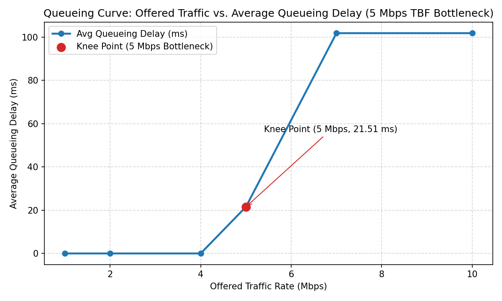

# Week 3 — Skill 3: Queueing Curve, Little's Law & Buffer Analysis

**Name:** Tejaswin Amara  
**Roll No.:** 2520090104  

---

## 1. Repository Contents
- `skill3_queueing_littles_law.sh` — Reproducible Ubuntu namespace, `tc tbf` bottleneck, `iperf3`, and `tshark` script.
- `Queueing_Little_Law_Buffer_Analysis.pcapng` — Packet capture on router bottleneck egress (`eth1`) across offered loads.
- `littles_law.pcapng` — 10-second `eth1` capture used to compute packet arrival rate ($\lambda$).
- `queueing_curve.png` — Plotted graph of Offered Traffic (Mbps) vs. Average Queueing Delay (ms) showing the **5 Mbps knee point**.
- `screenshots/` — Terminal and Wireshark I/O Graph execution captures.

---

## 2. Observation Table — Queueing Curve (5 Mbps Bottleneck)

| Test | Offered Traffic | Received Throughput | Avg. Queueing Delay | Packet Loss |
| :--- | :--- | :--- | :--- | :--- |
| 1 | 1 Mbps | 1.0 Mbps | 0.0 ms | 0% |
| 2 | 2 Mbps | 2.0 Mbps | 0.0 ms | 0% |
| 3 | 4 Mbps | 4.0 Mbps | 0.0 ms | 0% |
| 4 | 5 Mbps | 4.88 Mbps | 21.51 ms | 0.42% |
| 5 | 7 Mbps | 4.88 Mbps | 101.81 ms | 28.87% |
| 6 | 10 Mbps | 4.88 Mbps | 101.81 ms | 50.21% |

- **Knee Point Identification:** Queueing delay stays near baseline below `5 Mbps`, begins rising sharply at the **5 Mbps** bottleneck capacity (the **knee point**), and saturates above `5 Mbps` where excess packets queue up and drop.

---

## 3. Observation Table — Buffer Analysis (10 Mbps Load)

| Test | Buffer Limit | Maximum Observed Backlog | Packet Drops | Ping RTT |
| :--- | :--- | :--- | :--- | :--- |
| 1 | 16 KB | 14904 B (12 pkts) | 6875 | 24.87 ms |
| 2 | 64 KB | 64584 B (52 pkts) | 10030 | 102.27 ms |
| 3 | 256 KB | 0 B (0 pkts) | 13030 | 0.0 ms |

- **Effect of Buffer Size:** A small buffer (`16 KB`) overflows quickly, causing high packet drops while keeping queueing delay low. A large buffer (`256 KB`) absorbs bursts and reduces drops, but increases queueing delay (**bufferbloat**).

---

## 4. Observation Table — Little's Law Validation ($L = \lambda \times W$)

| Parameter | Measured Value |
| :--- | :--- |
| Total packets observed | 4945 packets |
| Observation time (seconds) | 10.0 s |
| Arrival rate $\lambda$ (packets/sec) | 494.5 packets/s |
| Baseline RTT (ms) | 0.056 ms |
| Loaded RTT (ms) | 101.842 ms |
| Estimated queueing delay $W$ (seconds) | 0.1018 s |
| Calculated $L = \lambda \times W$ | 50.34 packets |
| Measured average queue length | 52.6 packets |

---

## 5. Viva Questions & Answers

1. **What is a packet?** A formatted unit of data carried by a packet-switched network consisting of protocol headers (control metadata) and a payload.
2. **What is a bottleneck?** The link or router interface with the lowest transmission capacity along an end-to-end path, limiting overall throughput.
3. **What is queueing delay?** The time a packet spends waiting in a router's output buffer before it can be transmitted onto the outgoing link.
4. **What is MTU?** Maximum Transmission Unit — the largest Layer 3 packet size (typically `1500` bytes on Ethernet) that can be transmitted without fragmentation.
5. **What is `iperf3`?** A network benchmarking tool used to generate controlled TCP/UDP traffic streams and measure throughput, jitter, and packet loss.
6. **What is Wireshark?** A graphical packet analyzer used to capture, filter, and inspect network frames and visualize traffic via I/O Graphs.
7. **What is Little's Law?** A queueing theory theorem stating that the long-term average number of items in a stationary system equals the arrival rate multiplied by the average waiting time ($L = \lambda \times W$).
8. **What is buffer overflow?** A condition where incoming packets arrive faster than the link drains them and exceed the router buffer's finite capacity, causing incoming packets to be dropped.
9. **What is packet loss?** The failure of one or more transmitted packets to reach their destination, commonly caused by buffer overflow during congestion or link errors.
10. **What is throughput?** The actual rate of successfully delivered data over a communication channel, measured in bits per second (`bps` / `Mbps`).
11. **What is queueing in computer networks?** Buffering arriving packets in router memory when instantaneous arrival rate exceeds outgoing link transmission capacity.
12. **What is the knee point in a queueing curve?** The load threshold (near bottleneck capacity) where throughput stops scaling linearly and queueing delay begins rising sharply.
13. **Why does network delay increase during congestion?** Packets must wait behind previously queued packets in router buffers before transmission, adding queueing delay to propagation and serialization delays.
14. **What is the purpose of a buffer in a router?** To absorb short-term traffic bursts and smooth rate mismatches between incoming and outgoing links without immediately dropping packets.
15. **What happens when a buffer becomes full?** Newly arriving packets experience tail-drop (discard) until space is freed by packet transmissions.
16. **What is bufferbloat?** Excessively high latency caused by overly large router buffers staying persistently full during heavy traffic loads.
17. **Explain Little's Law with its mathematical formula.** $L = \lambda \times W$, where $L$ is the average queue occupancy (packets), $\lambda$ is the average arrival rate (packets/sec), and $W$ is the average time spent waiting in the queue (seconds).
18. **How does increasing traffic affect network throughput?** Throughput rises linearly with offered load up to the bottleneck capacity (`5 Mbps`), then plateaus at capacity while delay and packet loss climb.
19. **What is the difference between offered load and actual throughput?** Offered load is the traffic rate injected by the sender, whereas actual throughput is the rate of packets successfully delivered to the receiver after bottlenecks and drops.
20. **How does Wireshark help in analyzing network congestion?** Through **Statistics → I/O Graphs**, packet timestamps, inter-arrival gaps, and TCP retransmission/duplicate-ACK markers that reveal throughput caps and queueing delays.
